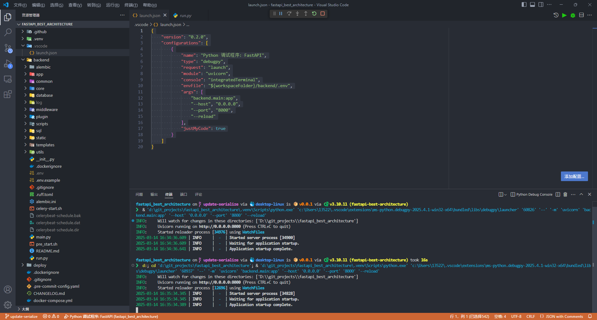

[**Visual Studio Code** 官网](https://code.visualstudio.com/){.read-more}

## DEBUG

如果你想在 vscode 中对 fba 进行调试，请创建 `.vscode/launch.json` 文件并添加以下配置

{
  "version": "0.2.0",
  "configurations": [
    {
      "name": "fba 调试程序",
      "type": "debugpy",
      "request": "launch",
      "program": "${workspaceFolder}/backend/run.py",
      "console": "integratedTerminal",
      "cwd": "${workspaceFolder}/backend",
      // 指定 python 解释器，请根据实际情况自行修改
      //"python": "${workspaceFolder}/.venv/bin/python", // MacOS or Linux
      //"python": "${workspaceFolder}/.venv/Scripts/python.exe",  // Windows
      "env": {
        "PYTHONPATH": "${workspaceFolder};${env:PYTHONPATH}"
      },
      "envFile": "${workspaceFolder}/backend/.env",
      "justMyCode": true
    },
    {
      "name": "Python 调试程序",
      "type": "debugpy",
      "request": "launch",
      "program": "${file}",
      "console": "integratedTerminal",
      // 指定 python 解释器，请根据实际情况自行修改
      //"python": "${workspaceFolder}/.venv/bin/python", // MacOS or Linux
      //"python": "${workspaceFolder}/.venv/Scripts/python.exe",  // Windows
      "env": {
        "PYTHONPATH": "${workspaceFolder};${env:PYTHONPATH}"
      },
      "envFile": "${workspaceFolder}/backend/.env",
      "justMyCode": true
    }
  ]
}

### 效果图

