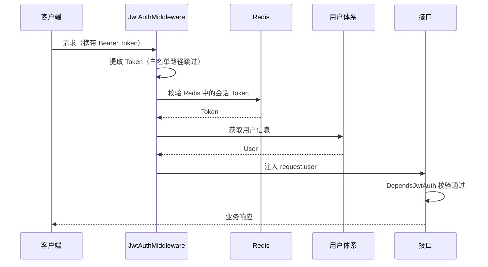

我们编写了 JWT 授权中间件，使其可以在每次请求发起时，能够实现自动授权，并且还使用 Redis 和 PyJWT
库对用户信息进行缓存和解析，使其性能影响尽可能降到最低

## 授权流程

JWT 的解析与校验由中间件完成，接口层只需挂载依赖



## 中间件

中间件位于 `backend/middleware/jwt_auth_middleware.py`，基于 Starlette 的 `AuthenticationBackend` 实现，并在 `backend/core/registrar.py` 中注册

```python
# JWT auth
app.add_middleware(
    AuthenticationMiddleware,
    backend=JwtAuthMiddleware(),
    on_error=JwtAuthMiddleware.auth_exception_handler,
)
```

中间件会先从请求头中提取 Bearer Token

```python
@staticmethod
def extract_token(request: Request) -> str | None:
    """
    从请求中提取 Bearer Token

    :param request: FastAPI 请求对象
    :return:
    """
    authorization = request.headers.get('Authorization')
    if not authorization:
        return None

    path = request.url.path
    if path in settings.TOKEN_REQUEST_PATH_EXCLUDE:
        return None
    for pattern in settings.TOKEN_REQUEST_PATH_EXCLUDE_PATTERN:
        if pattern.match(path):
            return None

    scheme, token = get_authorization_scheme_param(authorization)
    if scheme.lower() != 'bearer':
        return None

    return token
```

随后调用 `jwt_authentication()` 完成 Token 解码与 Redis 会话校验，并把用户信息写入 `request.user`

```python
async def jwt_authentication(token: str) -> JwtUser:
    """
    JWT 认证

    :param token: JWT token
    :return:
    """
    token_payload = jwt_decode(token)
    ctx.user_id = token_payload.user_id
    redis_token = await redis_client.get(f'{settings.TOKEN_REDIS_PREFIX}:{ctx.user_id}:{token_payload.session_uuid}')
    if not redis_token:
        raise errors.TokenError(msg='Token 已过期')
    if token != redis_token:
        raise errors.TokenError(msg='Token 已失效')
    ...
```

::: tip
Token 会话保存在 Redis 中，键格式为 `{TOKEN_REDIS_PREFIX}:{user_id}:{session_uuid}`，会话失效（如强制下线、退出登录）后，即使 JWT 未过期也会立即失效
:::

## 接口鉴权

在文件 `backend/common/security/jwt.py` 中，包含以下代码

```python
def jwt_authentication_verify(
    request: Request,
    token: Annotated[HTTPAuthorizationCredentials, Depends(HTTPBearer())],
) -> str:
    """
    JWT 认证依赖

    :param request: FastAPI 请求对象
    :param token: HTTP Bearer 认证信息
    :return:
    """
    if isinstance(request.user, UnauthenticatedUser):
        if token_exception := ctx.get('__request_jwt_authentication_exception__'):
            raise token_exception
        raise errors.TokenError
    return token.credentials


# JWT 依赖注入
DependsJwtAuth = Depends(jwt_authentication_verify)
```

我们通过在接口函数中添加此依赖实现 JWT 快速校验，它会确认请求已被中间件认证通过，使用方式参考如下：

```python{1}
@router.get('/hello', summary='你好', dependencies=[DependsJwtAuth])
async def hello():
    ...
```

::: warning
如果接口路径命中 `TOKEN_REQUEST_PATH_EXCLUDE` 或 `TOKEN_REQUEST_PATH_EXCLUDE_PATTERN` 白名单，中间件不会解析 Token，此时 `request.user` 不可用
:::

## Token

内置 token 授权方式遵循 [rfc6750](https://datatracker.ietf.org/doc/html/rfc6750)

## Swagger 登录

这是一种快捷的授权方式，仅用于调试目的，在服务启动后，进入 Swagger 文档，可通过此调试接口快速获取 token（无需验证码）

对应接口：`POST /api/v1/auth/login/swagger`

## 验证码登录

你可以通过此方式获取 token，在大多数情况下，这更适用于配合前端实现登录授权

我们在 fba 中使用 [fast_captcha](https://github.com/wu-clan/fast-captcha) 生成 base64 验证码，然后通过接口进行数据返回；您可以通过在线
base64 转图片或配合前端项目将其转为图片进行预览

对应接口：`GET /api/v1/auth/captcha`（获取验证码）、`POST /api/v1/auth/login`（登录）

### 授权流程

```sequence 验证码登录逻辑
actor 客户端
客户端 ->> 路由: GET<br/>/api/v1/auth/captcha
路由 ->> 频率限制器: 校验请求频率
频率限制器 -->> 路由: 允许
路由 ->> fast_captcha: 生成随机验证码
fast_captcha ->> Redis: 缓存验证码
客户端 ->> 路由: POST<br/>/api/v1/auth/login
路由 ->> 频率限制器: 校验请求频率
频率限制器 -->> 路由: 允许
路由 ->> 用户名: 校验用户名是否在系统中存在
用户名 -->> 路由: 通过
路由 ->> 验证码: 校验验证码（缓存和图片内容）
验证码 -->> 路由: 通过
路由 ->> Token: 生成 Token
Token -->> 客户端: 成功
```
