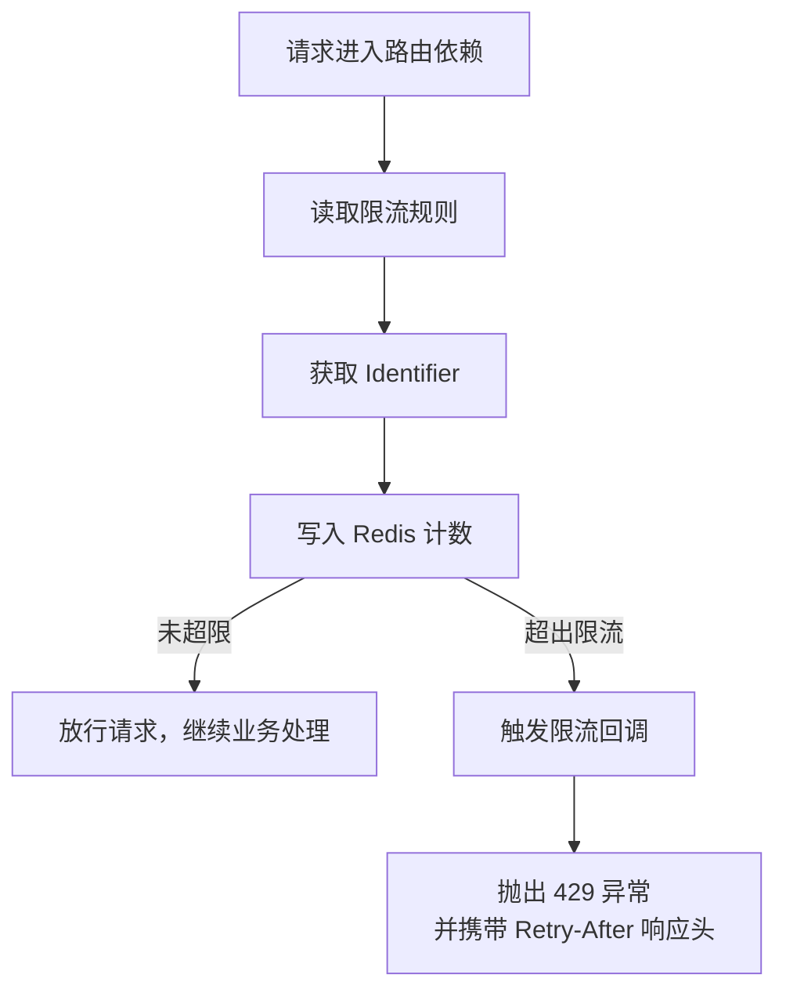

在现代 Web 开发中，API 限流（Rate
Limiting）是保护后端服务、防止资源滥用、保证服务稳定性的重要机制，我们有一个关于路由器的历史讨论，如果你感兴趣，可以查看：[#70](https://github.com/fastapi-practices/fastapi-best-architecture/discussions/70)

fba 使用 [fastapi-redis-sdk](https://pypi.org/project/fastapi-redis-sdk/) 提供的限流能力，并在 `backend/common/limiter.py` 中做了一层薄封装

## 处理流程

以下是限流处理一次请求的完整流程：



## 使用方法

限流被封装为路由级依赖，直接在路由中使用 `Depends` 注入

### 验证码接口

登录验证码是最容易被刷的接口，fba 对它做了「每 30 秒 5 次」的限制（`backend/app/admin/api/v1/auth/captcha.py`）

```python
from fastapi import Depends

from backend.common.limiter import rate_limit


@router.get(
    '/captcha',
    summary='获取登录验证码',
    dependencies=[Depends(rate_limit('5/30seconds'))],
)
async def get_captcha(db: CurrentSession) -> ResponseSchemaModel[GetCaptchaDetail]:
    ...
```

### 登录接口

用户登录接口的限制为「每分钟 5 次」（`backend/app/admin/api/v1/auth/auth.py`）

```python
@router.post(
    '/login',
    summary='用户登录',
    description='json 格式登录, 仅支持在第三方api工具调试, 例如: postman',
    dependencies=[Depends(rate_limit('5/minute'))],
)
async def login(
    db: CurrentSessionTransaction,
    response: Response,
    obj: AuthLoginParam,
    background_tasks: BackgroundTasks,
) -> ResponseSchemaModel[GetLoginToken]:
    ...
```

OAuth 2.0 插件的 GitHub、Google 授权回调接口同样使用 `rate_limit('5/minute')`

### 限流规则

规则使用 `次数/时间窗口` 的字符串表达式描述

| 表达式 | 说明 |
|-----|-----|
| `5/minute` | 每分钟 5 次 |
| `5/30seconds` | 每 30 秒 5 次 |
| `100/hour` | 每小时 100 次 |

### 自定义 Identifier

默认使用客户端 IP 作为限流标识（`backend/utils/request_parse.py` 的 `get_request_ip`），可以通过 `identifier` 参数覆盖

```python
from fastapi import Depends, Request

from backend.common.limiter import rate_limit


async def user_identifier(request: Request) -> str:
    return f'user:{request.user.id}'


@router.get(
    '',
    dependencies=[
        Depends(rate_limit('50/minute', identifier=user_identifier)),
    ]
)
async def user_data():
    ...
```

## 限流命中

命中限流时，fba 的回调会抛出项目统一异常，由全局异常处理器输出统一响应体格式，并附带 `X-RateLimit-Retry-After` 响应头

```python
def rate_limit_exceeded(request: Request, result: RateLimitResult) -> Response:
    """
    限流命中回调

    抛回项目统一异常，复用全局异常处理器输出的响应体格式与 trace_id

    :param request: FastAPI 请求对象
    :param result: SDK 限流结果
    :return:
    """
    raise errors.HTTPError(
        code=StandardResponseCode.HTTP_429,
        msg=t('response.rate_limit'),
        headers={'X-RateLimit-Retry-After': str(result.retry_after)},
    )
```

## 底层实现

限流后端由 fba 注入，复用项目自己的 Redis 连接池与生命周期

```python
async def get_fba_rate_limit_backend() -> RateLimitBackend:  # ruff: ignore[unused-async]
    """向 SDK 注入由 fba 管理的限流后端"""
    return RateLimitBackend(redis_client)
```

封装函数在 SDK 之上设置了默认策略

```python
def rate_limit(rate: str, **kwargs: Any) -> Callable[..., Awaitable[None]]:
    """
    构造路由级限流依赖

    :param rate: 限流规格，如 '5/minute'、'5/30seconds'
    :param kwargs: 透传 SDK `rate_limit` 的其余参数
    :return:
    """
    kwargs.setdefault('identifier', get_request_ip)
    kwargs.setdefault('on_limit_exceeded', rate_limit_exceeded)
    kwargs.setdefault('fail_closed', True)
    return sdk_rate_limit(rate, **kwargs)
```

其中 `fail_closed=True` 表示 Redis 不可用时采取「失败即拒绝」策略，避免限流失效导致服务被拖垮
