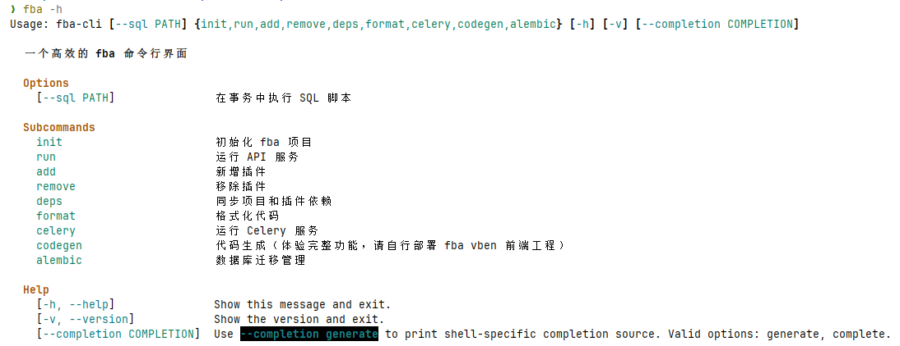

::: tip
If you use AI for initialization, migrations, formatting, or plugin installation, attach <FbaSkillInstall /> in the prompt so command order stays consistent with fba CLI conventions.
:::

fba includes a convenient CLI. After installing dependencies, try `fba -h` or `fba --help` in the terminal for more information.

::: window img

:::
