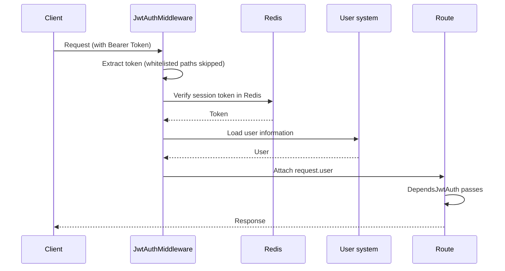

We wrote a JWT authorization middleware so every request can be authorized automatically. User information is also cached and parsed with Redis and PyJWT to keep the performance impact as low as possible.

## Authorization Flow

Tokens are decoded and verified by the middleware; API routes only mount a dependency



## Middleware

The middleware lives in `backend/middleware/jwt_auth_middleware.py`, is built on Starlette's `AuthenticationBackend`, and is registered in `backend/core/registrar.py`

```python
# JWT auth
app.add_middleware(
    AuthenticationMiddleware,
    backend=JwtAuthMiddleware(),
    on_error=JwtAuthMiddleware.auth_exception_handler,
)
```

It first extracts the Bearer token from the request header

```python
@staticmethod
def extract_token(request: Request) -> str | None:
    """
    从请求中提取 Bearer Token

    :param request: FastAPI 请求对象
    :return:
    """
    authorization = request.headers.get('Authorization')
    if not authorization:
        return None

    path = request.url.path
    if path in settings.TOKEN_REQUEST_PATH_EXCLUDE:
        return None
    for pattern in settings.TOKEN_REQUEST_PATH_EXCLUDE_PATTERN:
        if pattern.match(path):
            return None

    scheme, token = get_authorization_scheme_param(authorization)
    if scheme.lower() != 'bearer':
        return None

    return token
```

Then it calls `jwt_authentication()` to decode the token, verify the session in Redis, and attach the user to `request.user`

```python
async def jwt_authentication(token: str) -> JwtUser:
    """
    JWT 认证

    :param token: JWT token
    :return:
    """
    token_payload = jwt_decode(token)
    ctx.user_id = token_payload.user_id
    redis_token = await redis_client.get(f'{settings.TOKEN_REDIS_PREFIX}:{ctx.user_id}:{token_payload.session_uuid}')
    if not redis_token:
        raise errors.TokenError(msg='Token 已过期')
    if token != redis_token:
        raise errors.TokenError(msg='Token 已失效')
    ...
```

::: tip
Token sessions live in Redis under `{TOKEN_REDIS_PREFIX}:{user_id}:{session_uuid}`. Once a session is revoked (forced logout, sign out, ...), the token stops working immediately even if the JWT itself has not expired
:::

## API Authentication

The file `backend/common/security/jwt.py` includes the following code:

```python
def jwt_authentication_verify(
    request: Request,
    token: Annotated[HTTPAuthorizationCredentials, Depends(HTTPBearer())],
) -> str:
    """
    JWT 认证依赖

    :param request: FastAPI 请求对象
    :param token: HTTP Bearer 认证信息
    :return:
    """
    if isinstance(request.user, UnauthenticatedUser):
        if token_exception := ctx.get('__request_jwt_authentication_exception__'):
            raise token_exception
        raise errors.TokenError
    return token.credentials


# JWT 依赖注入
DependsJwtAuth = Depends(jwt_authentication_verify)
```

Add this dependency to an API function for quick JWT validation. It confirms that the middleware has authenticated the request. Example:

```python{1}
@router.get('/hello', summary='你好', dependencies=[DependsJwtAuth])
async def hello():
    ...
```

::: warning
When the route path matches the `TOKEN_REQUEST_PATH_EXCLUDE` or `TOKEN_REQUEST_PATH_EXCLUDE_PATTERN` whitelist, the middleware does not parse the token and `request.user` is unavailable
:::

## Token

The built-in token authorization follows [rfc6750](https://datatracker.ietf.org/doc/html/rfc6750).

## Swagger Login

This is a quick authorization method for debugging only. After the service starts, open the Swagger docs and use this debug endpoint to obtain a token quickly (no captcha required).

Endpoint: `POST /api/v1/auth/login/swagger`

## Captcha Login

You can obtain a token this way. In most cases this is better suited for frontend login authorization.

In fba we use [fast_captcha](https://github.com/wu-clan/fast-captcha) to generate a base64 captcha, then return it via the API. You can convert base64 to an image online or use the frontend project to preview it as an image.

Endpoints: `GET /api/v1/auth/captcha` (get captcha) and `POST /api/v1/auth/login` (sign in)

### Authorization Flow

```sequence Captcha login flow
actor Client
Client ->> Router: GET<br/>/api/v1/auth/captcha
Router ->> Rate limiter: Check request rate
Rate limiter -->> Router: Allowed
Router ->> fast_captcha: Generate random captcha
fast_captcha ->> Redis: Cache captcha
Client ->> Router: POST<br/>/api/v1/auth/login
Router ->> Rate limiter: Check request rate
Rate limiter -->> Router: Allowed
Router ->> Username: Check username exists in system
Username -->> Router: Passed
Router ->> Captcha: Validate captcha (cache and image content)
Captcha -->> Router: Passed
Router ->> Token: Generate Token
Token -->> Client: Success
```
