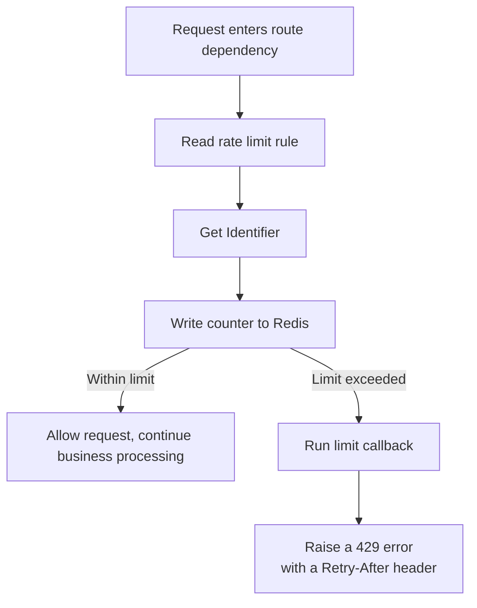

In modern web development, API rate limiting is an important mechanism for protecting backend services, preventing resource abuse, and ensuring service stability. We have a historical discussion on this topic if you are interested: [#70](https://github.com/fastapi-practices/fastapi-best-architecture/discussions/70)

fba uses the rate limiting provided by [fastapi-redis-sdk](https://pypi.org/project/fastapi-redis-sdk/) and wraps it with a thin layer in `backend/common/limiter.py`

## Processing Flow

The full flow when the rate limiter handles a request:



## Usage

Rate limiting is exposed as a route-level dependency and injected with `Depends`

### Captcha Endpoint

The login captcha is the most easily abused endpoint, so fba limits it to 5 requests per 30 seconds (`backend/app/admin/api/v1/auth/captcha.py`)

```python
from fastapi import Depends

from backend.common.limiter import rate_limit


@router.get(
    '/captcha',
    summary='获取登录验证码',
    dependencies=[Depends(rate_limit('5/30seconds'))],
)
async def get_captcha(db: CurrentSession) -> ResponseSchemaModel[GetCaptchaDetail]:
    ...
```

### Login Endpoint

The login endpoint is limited to 5 requests per minute (`backend/app/admin/api/v1/auth/auth.py`)

```python
@router.post(
    '/login',
    summary='用户登录',
    description='json 格式登录, 仅支持在第三方api工具调试, 例如: postman',
    dependencies=[Depends(rate_limit('5/minute'))],
)
async def login(
    db: CurrentSessionTransaction,
    response: Response,
    obj: AuthLoginParam,
    background_tasks: BackgroundTasks,
) -> ResponseSchemaModel[GetLoginToken]:
    ...
```

The OAuth 2.0 plugin's GitHub and Google callback endpoints use `rate_limit('5/minute')` as well

### Rules

Rules are written as a `count/window` string expression

| Expression | Description |
|-----|-----|
| `5/minute` | 5 requests per minute |
| `5/30seconds` | 5 requests per 30 seconds |
| `100/hour` | 100 requests per hour |

### Custom Identifier

The client IP is used as the identifier by default (`get_request_ip` from `backend/utils/request_parse.py`); pass `identifier` to override it

```python
from fastapi import Depends, Request

from backend.common.limiter import rate_limit


async def user_identifier(request: Request) -> str:
    return f'user:{request.user.id}'


@router.get(
    '',
    dependencies=[
        Depends(rate_limit('50/minute', identifier=user_identifier)),
    ]
)
async def user_data():
    ...
```

## When the Limit Is Hit

On a limit hit, fba's callback raises the project-wide exception, which the global exception handler renders with the unified response body and a `X-RateLimit-Retry-After` header

```python
def rate_limit_exceeded(request: Request, result: RateLimitResult) -> Response:
    """
    限流命中回调

    抛回项目统一异常，复用全局异常处理器输出的响应体格式与 trace_id

    :param request: FastAPI 请求对象
    :param result: SDK 限流结果
    :return:
    """
    raise errors.HTTPError(
        code=StandardResponseCode.HTTP_429,
        msg=t('response.rate_limit'),
        headers={'X-RateLimit-Retry-After': str(result.retry_after)},
    )
```

## Under the Hood

The rate limit backend is injected by fba and reuses the project's own Redis connection pool and lifecycle

```python
async def get_fba_rate_limit_backend() -> RateLimitBackend:  # ruff: ignore[unused-async]
    """向 SDK 注入由 fba 管理的限流后端"""
    return RateLimitBackend(redis_client)
```

The wrapper sets the default policies on top of the SDK

```python
def rate_limit(rate: str, **kwargs: Any) -> Callable[..., Awaitable[None]]:
    """
    构造路由级限流依赖

    :param rate: 限流规格，如 '5/minute'、'5/30seconds'
    :param kwargs: 透传 SDK `rate_limit` 的其余参数
    :return:
    """
    kwargs.setdefault('identifier', get_request_ip)
    kwargs.setdefault('on_limit_exceeded', rate_limit_exceeded)
    kwargs.setdefault('fail_closed', True)
    return sdk_rate_limit(rate, **kwargs)
```

`fail_closed=True` means an unreachable Redis rejects requests instead of silently disabling the limit
