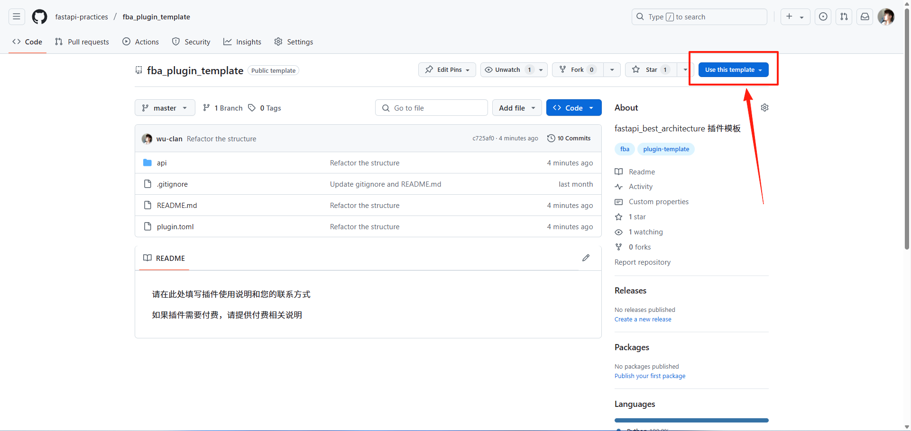

To share a plugin with others, you must create a public GitHub repository for it.

::: tip
Template repositories are optional. They only provide a quick public-repository skeleton. If you do not use a template, create a normal public repository that follows the directory and naming rules below.
:::

## Backend

::: warning Plugin repository naming rules
`plugin name == repository name` → `ai == ai`

Plugins are always unique. Installing plugins with the same name is not allowed, so keep plugin names as distinctive as possible.
:::

:::: steps

1. Create the plugin GitHub repository

   Prefer creating it from [fba_plugin_template](https://github.com/fastapi-practices/fba_plugin_template).
   The template currently has little substantive content — it mainly associates the plugin with fba.

   

2. Upload the code

   Commit all plugin code developed in fba to the newly created plugin GitHub repository.

   ::: important
   Copy all files inside the plugin directory, not the plugin directory itself.
   :::

::::

## Frontend

::: warning Plugin repository naming rules
- `plugin name == repository-name_ui` → `ai == ai_ui`
- `plugin name == repository-name-ui` → `ai-chat == ai-chat-ui`

To distinguish frontend plugins from backend ones, frontend plugin repository names must use a `_ui` or `-ui` suffix.

Plugins are always unique. Installing plugins with the same name is not allowed, so keep plugin names as distinctive as possible.
:::

:::: steps

1. Create a personal plugin repository

   Prefer creating it from [fba-ui-plugin-template](https://github.com/fastapi-practices/fba-ui-plugin-template), for the same reason as the backend.

2. Upload the code

   Commit all plugin code developed in the [frontend project](../frontend/summary/intro.md) to the newly created plugin GitHub repository.

   ::: important
   Copy all files inside the plugin directory, not the plugin directory itself.
   :::

::::

## Pre-Publish Checklist

Before publishing a plugin, confirm it meets these requirements:

- The plugin repository is public
- The repository name follows the naming rules in this document
- The repository root contains a `LICENSE` open source license file
- The plugin repository is tagged with the lowercase `fba-plugin` label (when using label inclusion)
- Backend plugin root contains `plugin.toml`, `README.md`, and `__init__.py`
- Frontend plugin root contains `plugin.toml`
- The repository root is the plugin root; do not add another plugin directory level
- Plugin info in `plugin.toml` is complete, with a version in `x.y.z` format
- Fields such as `tags` and `depends_on` follow the [Plugin Development](./dev.md) docs
- If the plugin includes models or SQL scripts, provide PostgreSQL init and destroy SQL
- `README.md` should cover configuration, usage, uninstallation, and feedback channels
- The plugin should not silently modify core files of the main project

You can use the [Plugin task](../ai/prompt.md#plugin-task) prompt to have an AI agent run the pre-publish checks. Git and GitHub write operations still require separate approval.

::: tip
The plugin author picks the license. Common choices are MIT, Apache-2.0, AGPL-3.0, and so on.

The marketplace reads the repository license and shows it on the plugin card.
:::

## Publishing a Plugin

The marketplace supports two inclusion routes. Pick either one; you do not need both.

- **Label inclusion**: once the plugin repository is on GitHub, tagging it with the lowercase `fba-plugin` label is enough. It is collected automatically, no PR required
- **PR inclusion**: open a PR against the [fba plugins repository](https://github.com/fastapi-practices/plugins); the fba team reviews it before it is listed

::: tip
Plugins are always unique. If the plugin name already exists, you must choose a new name for the plugin you are about to publish.
:::

### Route 1: Label Inclusion (No PR)

After the plugin repository is pushed to GitHub, tag it with the lowercase `fba-plugin` label. The marketplace collects it on the next sync, so no PR against the fba plugins repository is needed.

::: warning The label must be lowercase
The label name is always the lowercase `fba-plugin`. Names such as `FBA-Plugin` or `Fba-Plugin` are not recognized.
:::

#### Automatic Labeling (Recommended)

Create `.github/workflows/label-plugin.yml` in the plugin repository and reuse the official workflow:

```yaml
name: Label fba Plugin

on:
  push:
    branches:
      - main
      - master
  workflow_dispatch:

permissions:
  contents: write
  issues: write

jobs:
  label:
    uses: fastapi-practices/fastapi_best_architecture_docs/.github/workflows/label-plugin.yml@master
```

The workflow creates and applies the `fba-plugin` label on every push, and adds a topic with the same name. The label name is always lowercase.

You can also copy the official workflow file into `.github/workflows/label-plugin.yml` of the plugin repository.

::: tip
The label name is lowercased for you, so `FBA-Plugin` is still applied as `fba-plugin`.
:::

#### Manual Labeling

```shell
# 1. Create the label; the name must be lowercase. Ignore the error if it already exists
gh label create fba-plugin --repo your-username/your-plugin-name --color 0969da --description "fba plugin"

# 2. Create a marker issue and apply the label to it
gh issue create --repo your-username/your-plugin-name --title "fba plugin marker (fba-plugin)" --body "This issue carries the plugin marker label. Please keep it open." --label fba-plugin
```

You can also open `Issues -> New issue` on the repository and pick `fba-plugin` in the label list.

Once the label is applied, the marketplace lists the plugin on the next sync (within an hour). No PR is needed.

### Route 2: PR Inclusion

The marketplace tracks plugins with Git submodules, so this route requires a PR against the [fba plugins repository](https://github.com/fastapi-practices/plugins).

The plugin author should create the PR from their own GitHub account through a fork, so commits and the PR remain correctly attributed.

The fba team reviews against the pre-publish checklist and the plugin's actual purpose. Only after approval does the plugin appear in the [Plugin Marketplace](../marketplace.md).

#### Use an AI Agent (Recommended)

After installing <FbaSkillInstall />, give this prompt to an AI agent that supports Skills:

```markdown
Use the fba skill to check and publish the <plugin-name> plugin.

- Plugin type: <backend / frontend>
- Plugin repository: <https://github.com/...>
- Inclusion route: <label inclusion / PR inclusion>

After validation passes, wait for my confirmation, then tag the plugin repository with the lowercase `fba-plugin` label or create the marketplace PR with my GitHub account
```

The agent checks the repository structure, `plugin.toml`, SQL, duplicate plugins, and runs the marketplace validation. Validation reads files only and does not execute plugin code.

Before tagging or creating the PR, the agent shows the validation result and pending Git/GitHub operations. If GitHub CLI is unavailable or unauthenticated, it provides the browser links for labeling and for the PR instead of requiring you to install `gh`.

#### Manual Submission (Fallback)

Use the manual flow when you need to adjust the submodule manually or prefer the GitHub UI.

This flow requires Git to be installed locally.

:::: steps

1. Fork the repository

   [Open the fba plugins GitHub repository](https://github.com/fastapi-practices/plugins) and fork it to your account.

2. Clone the repository

   ```shell
   # Replace with the URL of the forked repository above
   git clone https://github.com/your-username/plugins.git
   ```

3. Create a branch

   ```shell
   # Replace add-your-plugin-branch
   git checkout -b add-your-plugin-branch
   ```

4. Add a submodule

   ```shell
   # Replace your-username and your-plugin-name
   # Backend plugin: plugins/your-plugin-name
   # Frontend plugin: plugins/your-plugin-name-ui or plugins/your_plugin_name_ui
   git submodule add https://github.com/your-username/your-plugin-name.git plugins/your-plugin-name
   git add plugins/your-plugin-name
   ```

   ::: warning
   All added submodules must use HTTPS URLs, not SSH URLs (git@github.com).
   :::

5. Commit and push

   ```shell
   # Replace your-plugin-name
   git commit -m "Add your-plugin-name plugin"
   ```

   ```shell
   # Replace add-your-plugin-branch
   git push --set-upstream origin add-your-plugin-branch
   ```

6. Create a PR

   Create a PR on GitHub.

7. Merge

   The fba team will review as soon as possible. Once your PR is merged, the plugin is published to the [Plugin Marketplace](../marketplace.md).

   The marketplace assigns four groups automatically: Backend / Frontend from the repository name, Official / Community from the repository owner. Repositories that follow the frontend suffix rule go to Frontend; repositories under `fastapi-practices` go to Official; everything else goes to Community.

   Plugins are also grouped by inclusion route: PR-included plugins go to "PR" and label-included plugins go to "Label".

::::

## Updating a Plugin

How you update depends on the inclusion route.

- **Label inclusion**: just push a new version to the plugin repository. The marketplace refreshes the plugin info and the update time on the next sync, with no extra step
- **PR inclusion**: open a PR against the fba plugins GitHub repository

Publish the new version in the plugin repository first, then update the marketplace submodule pointer. Do not point the submodule at an uncommitted or unpushed plugin revision.

For the PR route, follow the same steps as publishing, with these changes:

- Update the commands in step 4

  ```shell
  git submodule update --remote plugins/your-plugin-name
  git add plugins/your-plugin-name
  ```

- Update the commit message in step 5 — this is now an update, not an addition

::: info
To automate this process, you can use [GitHub Action](https://github.com/fastapi-practices/plugin-release).
:::

## Maintenance Responsibility

The marketplace helps users discover and install plugins, but maintenance remains the responsibility of the plugin author or their organization.

- Officially maintained plugins are maintained by the fba team or the fastapi-practices organization
- Community plugins are maintained by their authors
- Plugins that are long unmaintained, clearly risky, or no longer compatible with the current version may be marked, removed, or replaced with alternatives
- Plugin issues should preferably be reported to the corresponding plugin repository
- Issues related to the main project's plugin mechanism can be reported to the fba main project
