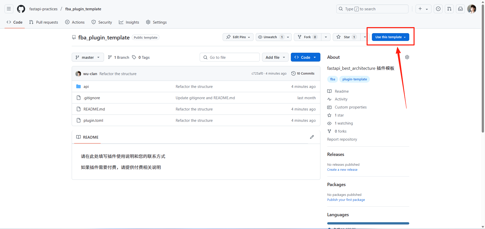

想要将插件与他人分享，您必须为此创建一个公开的 GitHub 仓库

::: tip
插件模板仓库不是强制入口，只用于快速创建公开仓库骨架。如果不使用模板，按本文的目录和命名规则创建普通公开仓库即可
:::

## 后端

::: warning 插件仓库命名规则
`插件名 == 仓库名` -> `ai == ai`

插件总是独一无二的，不允许安装同名插件，所以在对插件进行命名时，应尽量保持其独特性
:::

:::: steps

1. 创建插件 GitHub 仓库

   推荐通过 [fba_plugin_template](https://github.com/fastapi-practices/fba_plugin_template)
   创建。模板仓库内当前没有实质性内容，只是为了能够更好的将插件与 fba 关联起来

   

2. 上传代码

   将在 fba 中开发好的所有插件代码提交到刚刚创建的插件 GitHub 仓库中

   ::: important
   应拷贝插件目录中的所有文件，而不是拷贝插件目录
   :::

::::

## 前端

::: warning 插件仓库命名规则
- `插件名 == 仓库名_ui` -> `ai == ai_ui`
- `插件名 == 仓库名-ui` -> `ai-chat == ai-chat-ui`

为了更好的与后端插件进行区分，必须为前端插件仓库名添加 `_ui` 或 `-ui` 后缀

插件总是独一无二的，不允许安装同名插件，所以在对插件进行命名时，应尽量保持其独特性
:::

:::: steps

1. 创建个人插件仓库

   推荐通过 [fba-ui-plugin-template](https://github.com/fastapi-practices/fba-ui-plugin-template) 创建，原因与后端相同

2. 上传代码

   将在 [前端工程](../frontend/summary/intro.md) 中开发好的所有插件代码提交到刚刚创建的插件 GitHub 仓库中

   ::: important
   应拷贝插件目录中的所有文件，而不是拷贝插件目录
   :::

::::

## 发布前检查

在发布插件之前，请确认插件满足以下要求：

- 插件仓库为公开仓库
- 插件仓库命名符合当前文档中的命名规则
- 插件仓库根目录包含 `LICENSE` 开源许可证文件
- 插件仓库已添加 `fba-plugin` 主题（使用主题收录方式时）
- 后端插件根目录包含 `plugin.toml`、`README.md`、`__init__.py`
- 前端插件根目录包含 `plugin.toml`
- 仓库根目录就是插件根目录，不能再多包一层插件目录
- `plugin.toml` 中的插件信息完整，版本号符合 `x.y.z`
- `tags`、`depends_on` 等字段符合 [插件开发](./dev.md) 文档要求
- 如果插件包含模型或 SQL 脚本，应提供 PostgreSQL 的初始化和销毁 SQL
- `README.md` 应说明配置、使用方式、卸载方式和反馈方式
- 插件不应静默修改主项目核心文件

可以让 AI Agent 使用 [插件任务](../ai/prompt.md#插件任务) 提示词完成发布前检查，但 Git 和 GitHub 写操作仍需要单独授权

::: tip
许可证由插件作者自行选择，常见选择有 MIT、Apache-2.0、AGPL-3.0 等

插件市场会读取仓库的许可证标识，并展示在插件卡片上
:::

## 发布插件

插件市场支持两种收录方式，任选其一即可，不必同时使用

- **主题收录**：插件仓库上传到 GitHub 后，添加 `fba-plugin` 主题就会被自动收录，无需提交 PR
- **PR 收录**：向 [fba 插件仓库](https://github.com/fastapi-practices/plugins) 提交 PR，由 fba 团队审核后收录

::: tip
插件总是独一无二的，如果插件名已存在，那你只能选择为即将发布的插件换个新名字
:::

### 方式一：主题收录（无需 PR）

插件仓库上传到 GitHub 之后，只需要为仓库添加 `fba-plugin` 主题，插件市场就会在下一次同步时自动收录，无需向 fba 插件仓库提交 PR

::: tip 主题名建议使用全小写
采集端比较标签与主题时会统一转为小写，`FBA-Plugin`、`Fba-Plugin` 这类大小写写法同样能被识别，但字母必须一致，`FB-Plugin` 这类拼写无法识别；推荐仍统一使用全小写 `fba-plugin`，GitHub 的主题由平台规范为小写
:::

::: tip 主题与标签的关系
采集端先按主题 `fba-plugin` 检索候选仓库，再逐个核对标签与主题，两者命中其一即可收录。历史上有过「打标签 + 标记 issue」的写法，采集端仍然兼容，新插件只需添加主题
:::

#### 自动添加主题（推荐）

在插件仓库中新建 `.github/workflows/topic-plugin.yml`，引用官方工作流即可

```yaml
name: Mark fba Plugin

on:
  push:
    branches:
      - main
      - master
  workflow_dispatch:

permissions:
  contents: write

jobs:
  topic:
    uses: fastapi-practices/fastapi_best_architecture_docs/.github/workflows/topic-plugin.yml@master
```

该工作流在每次推送后自动写入 `fba-plugin` 主题，传入的主题名会被统一转为小写

也可以直接复制官方工作流文件到插件仓库的 `.github/workflows/topic-plugin.yml`

::: tip
主题名会被统一转为全小写，即使传入 `FBA-Plugin` 也会按 `fba-plugin` 处理
:::

#### 手动添加主题

在仓库 `Settings -> General -> Topics` 中添加 `fba-plugin` 主题即可，主题名由 GitHub 自动转为小写

采集端也兼容历史写法：在仓库的 `Issues -> New issue` 页面新建一条 issue，并在右侧标签列表中选择 `fba-plugin` 标签，同样能被收录

标记打完后，插件市场会在下一次同步（最多 1 小时）内收录该插件，无需再提交 PR

### 方式二：PR 收录

插件市场通过 Git submodule 跟踪插件，因此 PR 收录方式需要在 [fba 插件仓库](https://github.com/fastapi-practices/plugins) 创建一个 PR

PR 应由插件作者使用自己的 GitHub 账号从 fork 创建，确保提交和 PR 归属正确

fba 团队会根据发布前检查项和插件实际用途进行审核，通过后插件才会进入 [插件市场](../marketplace.md)

#### 使用 AI Agent（推荐）

安装 <FbaSkillInstall /> 后，将以下提示词交给支持 Skills 的 AI Agent：

```markdown
使用 fba skill 检查并发布 <插件名> 插件。

- 插件类型：<backend / frontend>
- 插件仓库：<https://github.com/...>
- 收录方式：<主题收录 / PR 收录>

自检通过后，等我确认，再以我的 GitHub 账号为插件仓库添加 `fba-plugin` 主题，或创建插件市场 PR
```

Agent 会检查仓库结构、`plugin.toml`、SQL 和重复插件，并运行插件市场校验。自检只读取文件，不会执行插件代码

打标签或创建 PR 前，Agent 会先展示校验结果和待执行的 Git/GitHub 操作。如果你没有安装或登录 GitHub CLI，Agent 会提供网页创建标签和 PR 的地址，不需要为此安装 `gh`

#### 手动提交（备用）

需要手动调整 submodule 或使用 GitHub 网页操作时，可以按以下步骤提交

手动方式需要本地安装 Git

:::: steps

1. Fork 仓库

   [进入 fba 插件 GitHub 仓库](https://github.com/fastapi-practices/plugins)，将仓库 fork 到个人账户

2. 克隆仓库

   ```shell
   # 将地址替换为上面 fork 的仓库地址
   git clone https://github.com/your-username/plugins.git
   ```

3. 创建分支

   ```shell
   # 注意替换 add-your-plugin-branch
   git checkout -b add-your-plugin-branch
   ```

4. 扩展子模块

   ```shell
   # 注意替换 your-username、your-plugin-name
   # 后端插件：plugins/your-plugin-name
   # 前端插件：plugins/your-plugin-name-ui 或 plugins/your_plugin_name_ui
   git submodule add https://github.com/your-username/your-plugin-name.git plugins/your-plugin-name
   git add plugins/your-plugin-name
   ```

   ::: warning
   所有扩展子模块必须使用 HTTPS URL，而不是 SSH URL（git@github.com）
   :::

5. 提交和推送

   ```shell
   # 注意替换 your-plugin-name
   git commit -m "Add your-plugin-name plugin"
   ```

   ```shell
   # 注意替换 add-your-plugin-branch
   git push --set-upstream origin add-your-plugin-branch
   ```

6. 创建 PR

   通过 GitHub 从你的分支创建 PR

7. 合并

   fba 团队将尽快完成检查，一旦您的 PR 合并，插件将被发布到 [插件市场](../marketplace.md)

   插件市场会自动归入四个分组：后端 / 前端由仓库名判断，官方 / 社区由仓库所属组织判断。仓库名符合前端后缀规则的进入前端分组，仓库属于 `fastapi-practices` 的进入官方分组，其余进入社区分组

   插件还会按收录方式归类：PR 收录的插件归入「PR 收录」，主题收录的插件归入「主题收录」

::::

## 更新插件

更新方式取决于收录方式

- **主题收录**：在插件仓库推送新版本即可，插件市场会在下一次同步时自动更新插件信息与更新时间，无需任何额外操作
- **PR 收录**：需要在 fba 插件 GitHub 仓库创建一个 PR

先发布插件仓库中的新版本，再更新插件市场的 submodule 指针。不要把 submodule 指向未提交或未推送的插件版本

==PR 收录方式下，执行与发布相同的步骤，并更新以下行为：==

- 更新步骤 4 中的命令

  ```shell
  git submodule update --remote plugins/your-plugin-name
  git add plugins/your-plugin-name
  ```

- 更新步骤 5 中的提交信息，现在已不再是新增，而是更新

::: info
如果你想自动执行此过程，可以使用 [GitHub Action](https://github.com/fastapi-practices/plugin-release)
:::

## 维护责任

插件市场用于帮助用户发现和安装插件，但插件的维护责任由插件作者或插件所属组织承担

- 官方维护的插件由 fba 团队或 fastapi-practices 组织维护
- 社区插件由插件作者维护
- 插件长期无人维护、存在明显风险或不再兼容当前版本时，可能被标记、移除或建议替代方案
- 插件问题应优先反馈到对应插件仓库
- 与主项目插件机制相关的问题，可以反馈到 fba 主项目
